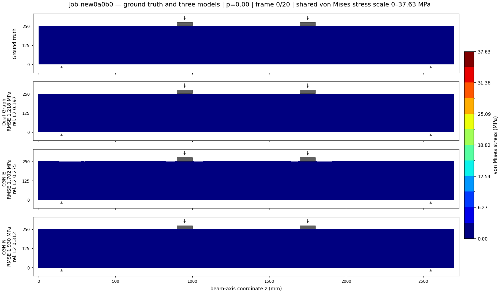
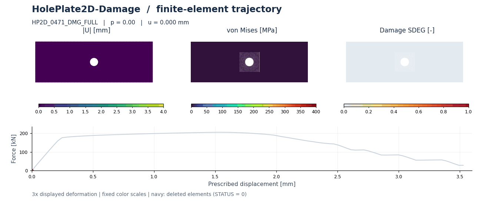

# Structural response benchmark previews

This repository presents two finite-element benchmark datasets for learning nonlinear structural response. Each benchmark has its own description, machine-readable case information, visualization assets, and helper scripts.

## Reinforced-concrete beam under four-point bending

**RCBeam3D-FourPointBending** studies nonlinear response as the two displacement-controlled loading blocks move along a reinforced-concrete beam.

[Open the beam benchmark card](four_point_bending/README.md) · [Model definitions](four_point_bending/models/README.md) · [Case manifest](four_point_bending/data/cases.csv)

## Perforated plate under tension with damage

**HolePlate2D-Damage-800** studies geometry-dependent plasticity, damage localization, and element deletion in a perforated plate under tension.

[Open the plate benchmark card](hole_plate_damage/README.md) · [Visualization gallery](hole_plate_damage/GALLERY.md) · [Data schema](hole_plate_damage/docs/DATA_SCHEMA.md)

## Repository contents

The repository contains benchmark documentation, case manifests, dataset cards, visualization assets, and reproducibility scripts. Raw solver archives (NPZ/HDF5/ODB) and trained checkpoints are not included. Refer to each benchmark card for the available data, scope, and current limitations.
