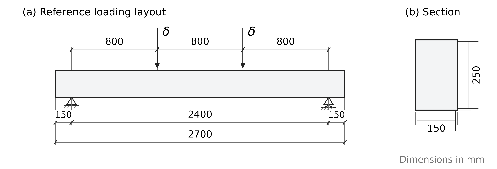
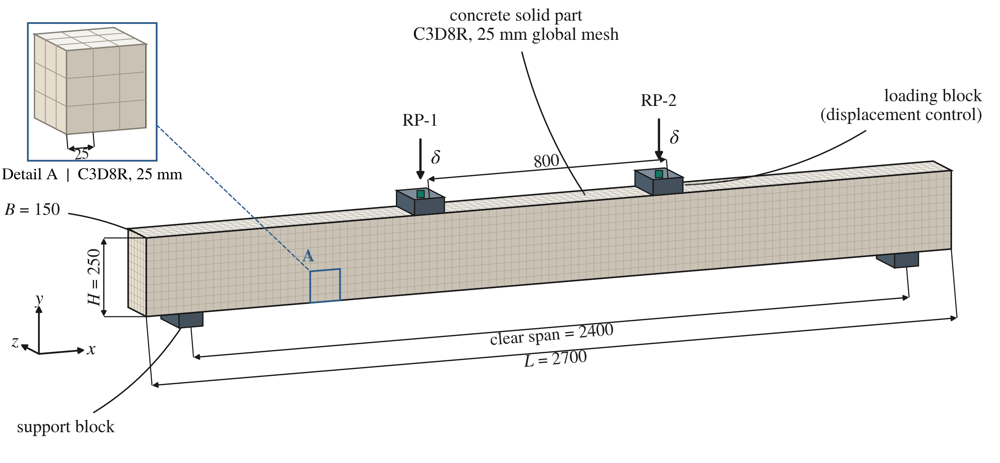
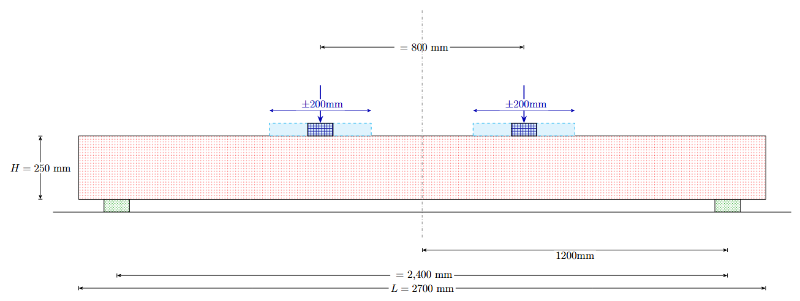
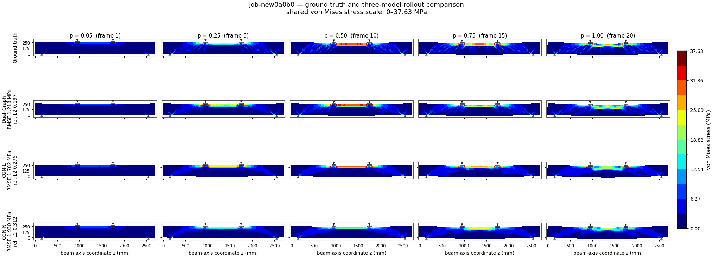
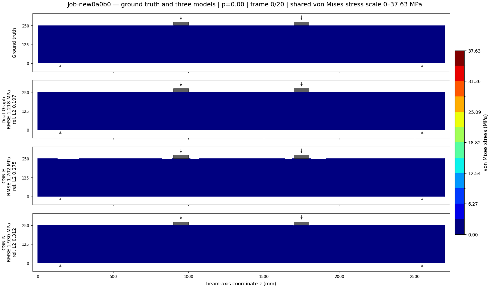
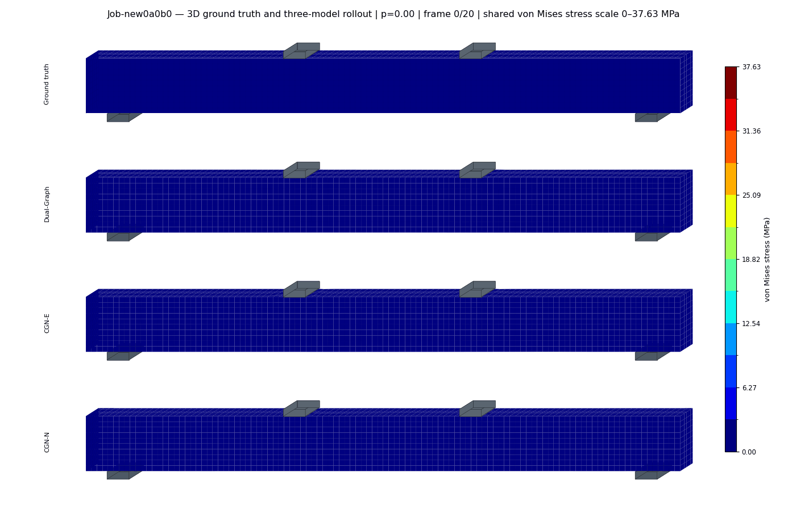

# RCBeam3D-FourPointBending

A dataset for learning nonlinear reinforced-concrete beam response under variable four-point loading.

## Figures



*Reference geometry of the CL30-based finite-element model: (a) beam elevation
and baseline displacement-controlled loading layout; (b) rectangular section.
The overall length is 2700 mm, the clear span is 2400 mm, and the section is
150 mm × 250 mm. The two loading points divide the reference span into three
800 mm segments. Dimensions are in mm; the specimen geometry follows Wang et al. [1].*



*Abaqus assembly used to generate the trajectories. Concrete is discretised by
C3D8R elements with a 25 mm global mesh; reinforcement is represented by
embedded T3D2 elements. The two upper blocks impose displacement control through
RP-1 and RP-2, while the two lower blocks provide the simple supports. This CAE
model numerically reproduces the physical four-point-bending experiment in [1].*



*Four-point-bending boundary conditions and parametric loading space. The
baseline loading-point separation is 800 mm. Each loading block moves
independently by up to ±200 mm in 25 mm mesh-aligned increments, producing both
symmetric and asymmetric bending configurations.*



*`Job-new0a0b0` von Mises stress snapshots at normalised loading progress
0.05, 0.25, 0.50, 0.75 and 1.00. Rows show the finite-element ground truth and
the three currently available rollout archives. All panels use the same
0–37.63 MPa scale fixed by the ground-truth trajectory. The displayed errors are
single-case diagnostics for this illustrated trajectory.*



*Synchronous 21-frame rollout for the same case. Geometry is shown at physical
deformation scale, and every row uses the same time index, support/loading
layout and stress colour scale.*



*Synchronous 21-frame three-dimensional rollout for `Job-new0a0b0`. The fixed
oblique viewpoint exposes the front, top and end surfaces while preserving the
physical deformation scale. All four rows share the same time index and
ground-truth-defined 0–37.63 MPa colour range. Loading blocks are centred at
950 and 1750 mm; supports are centred at 150 and 2550 mm and follow the actual
150 mm beam width.*

## Experimental basis and CAE provenance

This benchmark is not based on an abstract synthetic beam. Its specimen
geometry, reinforcement layout, support span and four-point-loading arrangement
are based on the laboratory investigation of initially loaded reinforced
concrete beams reported by Wang et al. [1]. The parametric Abaqus campaign
extends that experimentally grounded reference model by relocating the two
loading blocks while retaining the documented beam and support configuration.

## Data at a glance

- Solver: Abaqus/Standard, Static General, geometric nonlinearity enabled.
- Discretisation: 3D FEM; 6480 C3D8R concrete elements and 8393 concrete nodes
  in every inspected case; embedded T3D2 reinforcement.
- Loading: displacement-controlled four-point bending with two independently
  relocated upper loading blocks and two fixed supports.
- Geometry: 150 mm × 250 mm × 2700 mm beam; 2400 mm clear span; 25 mm concrete
  mesh.
- Materials: Concrete Damaged Plasticity for concrete and isotropic
  elastic-plastic reinforcement; perfect bond through an embedded-region
  constraint.
- Timeline: normalised loading progress.
- Fields: nodal displacement, element von Mises stress, element PEEQ, global
  vertical reaction force and prescribed loading-head displacement.
- File format: one HDF5 (`.h5`) file per loading case, using strict SI units
  (m, Pa and N) and zero-based connectivity.
- HDF5 schema `0.2.0`; dataset id `RC-Beam-4Point`.
- Provenance: parametric Abaqus campaign based on the physical CL30
  four-point-bending experiment reported in [1].
- Data license: to be specified with the dataset download.

## Task

Autoregressive load-progress-conditioned prediction of the full nonlinear beam
response. Given the fixed finite-element mesh, the two loading-region locations,
the unloaded initial state and the normalised progress sequence, a method rolls
out nodal displacement, element-wise von Mises stress, element-wise PEEQ and the
global vertical reaction-force history through the stored frames.

The benchmark is case-based: all frames belonging to one loading configuration
must remain in the same train, validation or test split. Models are evaluated
against the native nodal displacement and native element fields even when a
node-only method internally projects element quantities onto nodes.

## Evaluation criteria

- Protocol (provisional): use frame 0 as the unloaded initial state and roll out
  frames 1–20 at the native normalised progress levels.
- Trajectory metrics: displacement RMSE (mm), stress RMSE (MPa), PEEQ RMSE and
  reaction-force RMSE (kN).
- Scale-independent metrics: case-wise relative L2 error, coefficient of
  determination and per-step relative L2 error.
- Quantities of interest: peak load, displacement at peak load, terminal
  midspan deflection, peak von Mises stress and peak PEEQ.
- Visual diagnostics: identical frames, physical deformation scale and one
  ground-truth-defined colour range shared by every compared model.


## Loading-parameter convention

Case ids use `Job-new<index>a<A>b<B>`. Inspection of the flagged loading-surface
coordinates establishes the following mapping:

- `A` relocates the right loading block from its 1750 mm baseline centre.
- `B` relocates the left loading block from its 950 mm baseline centre.
- The resulting loading-point distance is `800 + A - B` mm.

For example, `Job-new100a-150b-25` places the right loading centre at 1600 mm
and the left centre at 925 mm. The complete mapping is recorded in
`data/cases.csv` in the standalone benchmark package.

## HDF5 benchmark format

Each loading configuration is stored as one self-contained
`<case_id>.h5` file. Geometry, connectivity, loading metadata and all 21
response frames remain together so that case-level train/validation/test splits
cannot separate frames from the same simulation.

```text
RCBeam3D-FourPointBending/
├── cases.csv
├── splits/
│   ├── train.txt
│   ├── validation.txt
│   └── test.txt
└── cases/
    ├── <case_id_000>.h5
    ├── <case_id_001>.h5
    └── ...
```

| Path | Shape | Meaning |
|---|---:|---|
| `nodes/coords` | `(8393, 3)` | Nodal coordinates in m |
| `nodes/reference_coords` | `(8393, 3)` | Reference nodal coordinates in m |
| `nodes/node_type` | `(8393,)` | Loading-surface indicator |
| `elements/solid/connectivity` | `(6480, 8)` | Zero-based C3D8 connectivity |
| `response/time/t` | `(21,)` | Normalised loading progress |
| `response/node/displacement` | `(21, 8393, 3)` | Nodal displacement in m |
| `response/element/solid/stress_scalar` | `(21, 6480)` | Element von Mises stress in Pa |
| `response/element/solid/peeq` | `(21, 6480)` | Element equivalent plastic strain |
| `response/global/rf2` | `(21,)` | Summed vertical reaction force in N |
| `response/global/head_u2` | `(21,)` | Loading-head displacement in m |

Required root attributes are `schema_version = "0.2.0"`,
`dataset_id = "RC-Beam-4Point"`, `case_id`, `solver = "Abaqus"` and
`units = "SI"`.

### Prediction submission format

Predictions use the same HDF5 case identity, time coordinate and spatial
locations as the ground truth. A submission stores one
`<case_id>_prediction.h5` per test case:

| Path | Shape | Meaning |
|---|---:|---|
| `prediction/time/t` | `(21,)` | Normalised loading progress |
| `prediction/node/displacement` | `(21, 8393, 3)` | Predicted nodal displacement in m |
| `prediction/element/solid/stress_scalar` | `(21, 6480)` | Predicted von Mises stress in Pa |
| `prediction/element/solid/peeq` | `(21, 6480)` | Predicted equivalent plastic strain |
| `prediction/global/rf2` | `(21,)` | Predicted reaction force in N |

## Compared methods

The visualizations compare finite-element ground truth with Dual-Graph GConvGRU,
CGN-E and CGN-N. The image annotations report errors for `Job-new0a0b0`.
See [model definitions](models/README.md) for architecture descriptions.

## Reproduce the visualizations

Install `requirements.txt`, then run:

```bash
python viz/compare_models.py --train-root /path/to/rollouts --case Job-new0a0b0
python viz/compare_models_3d.py --train-root /path/to/rollouts --case Job-new0a0b0
```

The rollout root contains `double_pre`, `single_element_pre` and
`single_node_pre`. Case data and checkpoints are separate from this preview package.

## References

[1] W. Wang, G. Zhao, C. Huang, and H. Ren, “An experimental study of
strengthening of initially loaded reinforced concrete beams using CFRP sheets,”
*Gongcheng Lixue (Engineering Mechanics)*, vol. 21, no. 4, pp. 172–178, 2004.

[2] Q. Li, Z. Wang, L. Li, H. Hao, W. Chen, and Y. Shao, “Machine learning
prediction of structural dynamic responses using graph neural networks,”
*Computers & Structures*, vol. 289, Art. no. 107188, 2023.
