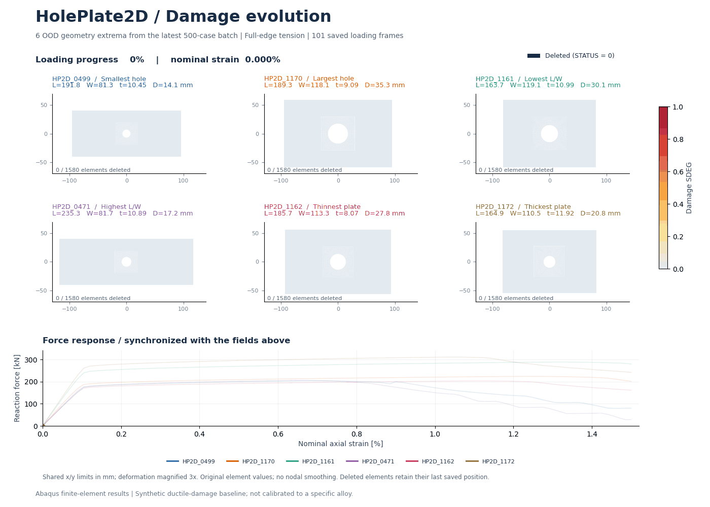
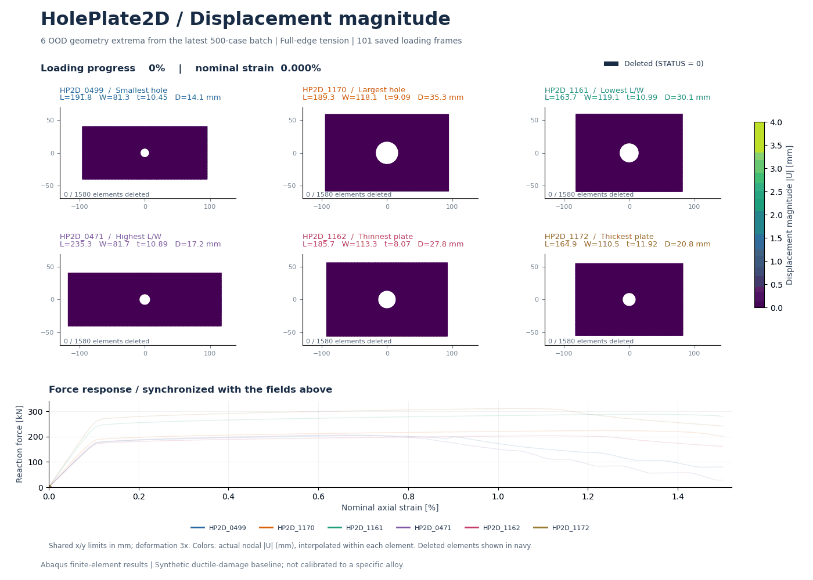
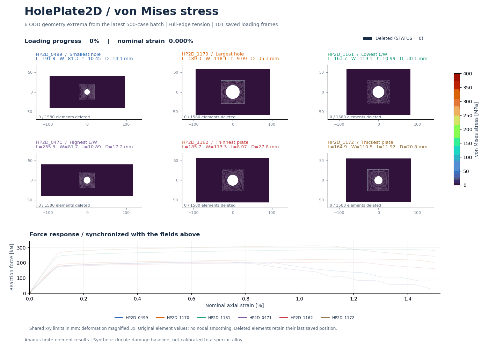
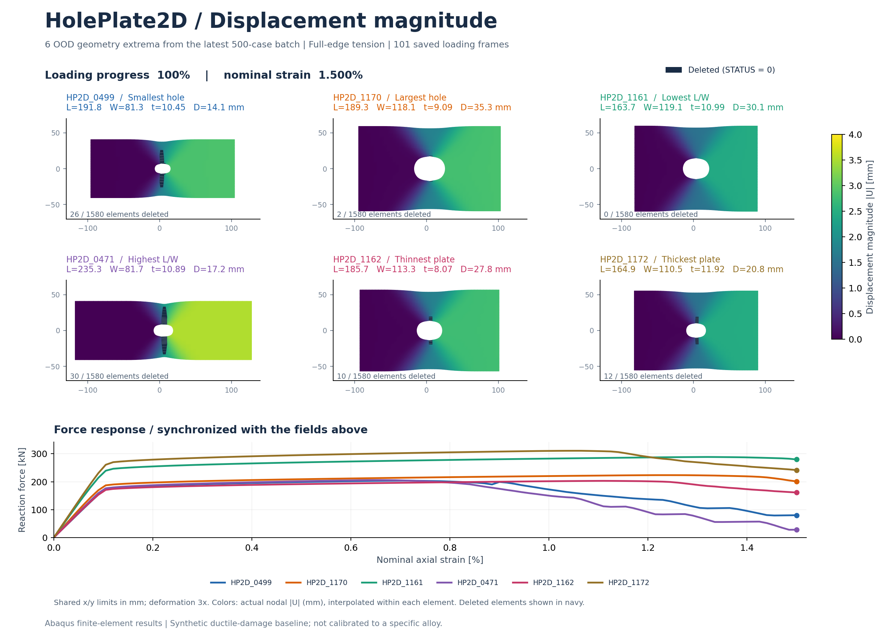
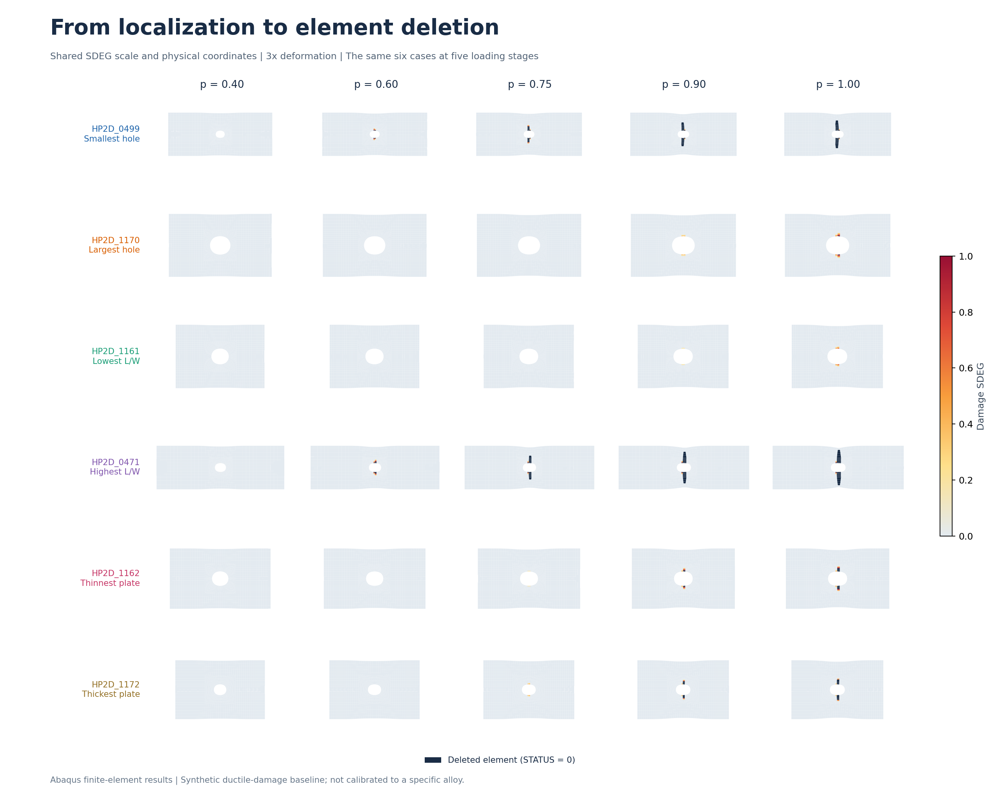
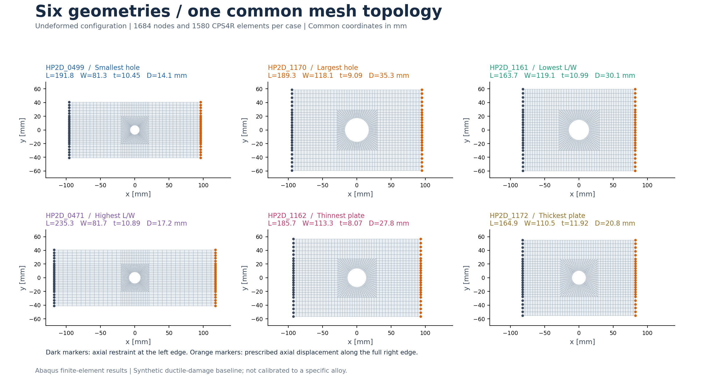
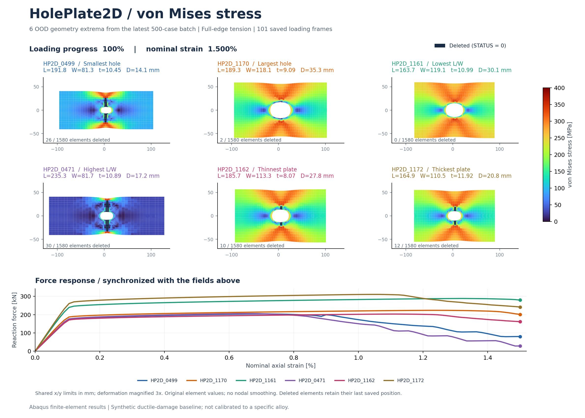
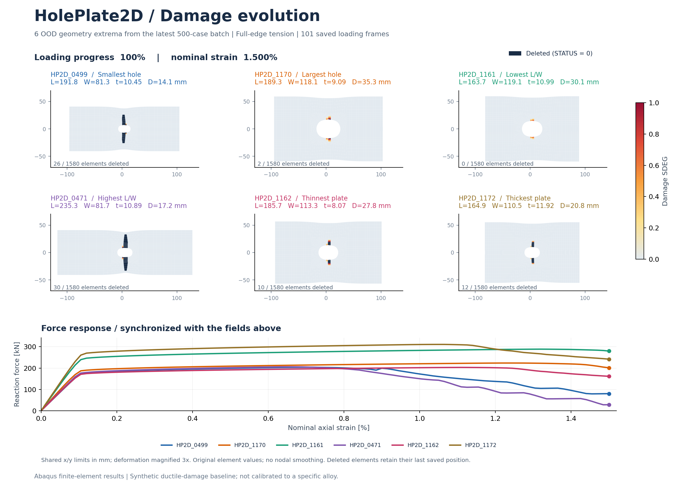

# HolePlate2D — Ductile damage under tension

Six finite-element trajectories of a steel plate with a central circular hole, showing damage localization, element deletion, and the associated force response.



**Reading the animation.** Pale grey indicates undamaged material; yellow to red indicates increasing damage (`SDEG`, from 0 to 1). Dark navy marks deleted elements (`STATUS = 0`) separately from the damage scale. The lower plot follows each case at the same loading progress. Geometry is shown with **3× displacement magnification**; force and strain are unscaled. All **101 saved frames** are included, with a pause at the end.

## Displacement and von Mises stress



Displacement colors show the actual nodal magnitude `|U| = sqrt(U1² + U2²)` in mm, on a shared **0–4 mm** scale across all cases and frames. Only the displayed geometry is magnified 3×. Each original quadrilateral is split into two triangles for Gouraud display of nodal colors; no nodes are added and no values are averaged across elements. Deleted elements are masked from the displacement field and identified in navy.



Von Mises stress uses the original element integration-point values, with a shared **0–400 MPa** scale and no nodal averaging. Both animations contain all 101 frames and use the same loading progress, deformation scale, and force histories as the damage animation.



## Loading stages



The same five loading progress values (`p = 0.40, 0.60, 0.75, 0.90, 1.00`) are used for every case. Damage starts at different stages for different geometries. A case can develop damage without deleting any elements by the final frame.

## Geometry and mesh



Cases are chosen deterministically from the **50 OOD cases in the latest 500-case full-edge-loading batch**, using the minimum and maximum hole diameter, length-to-width ratio, and thickness. These extrema refer to that OOD subset, not to the full historical dataset. Parameters vary jointly; this comparison is not a controlled single-parameter experiment.

| Case (suffix `_DMG_FULL`) | Selection | Final deleted elements |
|---|---|---:|
| HP2D_0499 | Smallest hole | 26 |
| HP2D_1170 | Largest hole | 2 |
| HP2D_1161 | Lowest L/W | 0 |
| HP2D_0471 | Highest L/W | 30 |
| HP2D_1162 | Thinnest plate | 10 |
| HP2D_1172 | Thickest plate | 12 |

## Final stress and damage





## Data and display conventions

- Solver: Abaqus; 2D plane stress, 1,684 nodes and 1,580 CPS4R elements per case.
- Loading: uniform prescribed axial displacement over the full right edge; final nominal axial strain 1.5%.
- Histories: 101 saved normalized progress values, from 0 to 1 in steps of 0.01. Animation time is playback time, not physical time.
- Damage: synthetic triaxiality-dependent ductile initiation with linear, displacement-based evolution. Failure displacement parameter: 0.25 mm.
- These are **finite-element outputs using a synthetic material baseline**, not experimentally calibrated alloy results and not neural-network predictions.
- Damage and stress colors use original element integration-point values, without nodal averaging or smoothing. Displacement colors use nodal magnitudes with triangle-based Gouraud rendering within the original elements.
- All cases use the same physical coordinate limits. Damage uses a fixed 0–1 scale; stress uses a fixed 0–400 MPa scale; displacement uses a fixed 0–4 mm scale covering the six complete histories.
- Deleted elements are rendered as navy footprints at their saved coordinates, to identify deletion locations. The footprint is not surviving material or a directly measured crack width.
- The bottom curves show reaction force versus nominal axial strain `u/L × 100%`, making cases of different lengths comparable.
- The source batch audit reports 500 completed damage cases and 498 with deletion. The six selected cases are a geometry showcase, not a statistical assessment of the full batch.

## Reproduce

```bash
python -m pip install -r requirements.txt
python scripts/render_damage_gallery.py --source "PATH/TO/HOLE_DATASET/hole_plate_2d_damage_full_edge_next_500"
```

The source directory must contain `cases_500.csv`, `results.csv`, and each selected case's `*_damage_gnn.npz` and `*_damage_summary.json`. Rendering is read-only with respect to the source. `selected_cases.json` and `selected_cases.csv` record the geometry, selection criteria, local source paths, SHA-256 hashes, and selected result metrics. Local paths are provenance records, not public download links. Source NPZ and ODB data are not bundled here.

This folder contains relative image links suitable for a GitHub README. Copy the folder contents to the desired repository location while preserving the `assets/` directory.
