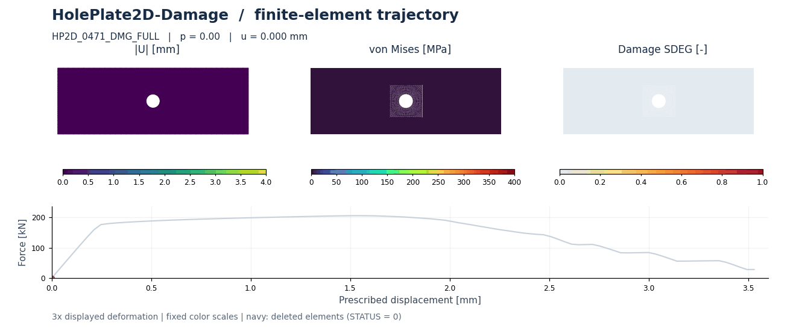
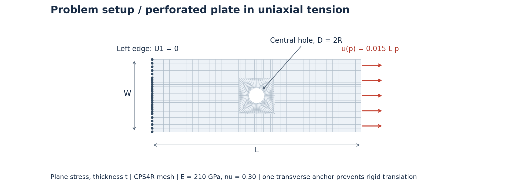
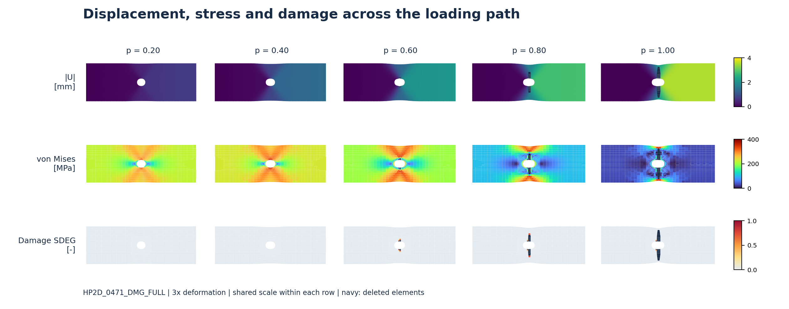

# HolePlate2D-Damage

**Geometry-dependent plasticity, damage localization and element deletion in a perforated plate under tension.**

[Full visualization gallery](GALLERY.md) · [Data schema](docs/DATA_SCHEMA.md) · [Dataset card](data/card.json)

> **Status:** 800 completed, non-overlapping finite-element cases across three full-edge batches; 101 loading frames per case. This package provides a dataset description and reproducible visualizations. Model predictions and benchmark scores are not included.



*A slender perforated plate develops a concentrated damage band above and below the hole while tensile force falls after the peak. Left to right: displacement magnitude, von Mises stress and SDEG; the force–displacement curve follows the same frame. Case HP2D_0471_DMG_FULL, OOD test split, L/W = 2.881. Navy footprints indicate deleted elements. Geometry is magnified 3×; field values and force are unscaled.*

## The problem

A circular hole interrupts the load path through a rectangular steel plate. As the right edge is pulled, stress concentrates around the hole, plastic deformation accumulates, and a ductile damage variable reduces the material response. Once the failure criterion is reached, individual elements are deleted. The trajectory couples a smooth displacement field to localized damage and a changing active mesh.

This dataset varies plate length, width, thickness and relative hole radius while retaining the same reference mesh connectivity. It is intended for structural surrogates that predict both spatial fields and the global tensile response, including the post-peak regime. It uses a **synthetic constitutive baseline** for computational studies, without calibration to a particular alloy or experiment.



*Plane-stress Abaqus model. The left edge is restrained axially and one node is anchored transversely. The full right edge receives U1 = 0.015 L p, where p runs from 0 to 1; transverse displacement remains free. L, W, t and R/W vary across cases. The illustrated mesh belongs to HP2D_0471_DMG_FULL.*

## Figures



*The same case at p = 0.20, 0.40, 0.60, 0.80 and 1.00. Rows show displacement magnitude (mm), von Mises stress (MPa), and damage SDEG. Each row has a fixed scale. Deleted elements are marked separately in navy, rather than treated as intact low-stress material.*

The [six-case gallery](GALLERY.md) includes full 101-frame animations for [displacement](assets/case-displacement-comparison.gif), [von Mises stress](assets/case-stress-comparison.gif) and [damage](assets/case-damage-comparison.gif), plus meshes and force curves. Cases are geometry extrema within the newest 500-case batch's OOD subset, not controlled single-parameter experiments.

## Data at a glance

| Item | Combined dataset |
|---|---|
| Dataset identifier | `HolePlate2D-Damage-800` |
| Solver / analysis | Abaqus/Standard; geometrically nonlinear static tension with automatic stabilization |
| Mesh | 1,684 nodes; 1,580 CPS4R plane-stress quadrilaterals; one integration point per element |
| Cases | 800 completed; all show damage; 791 show element deletion |
| Split | 560 train / 80 validation / 80 ID test / 80 OOD test |
| Loading history | 101 frames; p = 0.00, 0.01, …, 1.00 |
| Final nominal strain | 1.5%; prescribed displacement u = 0.015 L |
| Source units | mm, N, MPa; energy in N·mm |
| Storage | Extracted NPZ + JSON summary per case; Abaqus input and ODB source files |
| Outputs | Displacement, stress, von Mises, PEEQ, SDEG, STATUS, reaction and energy histories |
| Public data download | Not included in this local preview package |

This card combines **100 + 200 + 500 = 800 unique full-right-edge-loading cases**. All have completed solver results and extracted NPZ files, consistent loading and damage parameters, and 101 frames. The separate local-loading damage batch is excluded. The existing six-case visualization subset is selected from the newest 500-case batch, not from the entire 800-case dataset.

### Geometry and material

| Parameter | Actual range in all 800 cases |
|---|---:|
| Length L | 160.387–239.582 mm |
| Width W | 80.449–119.917 mm |
| Thickness t | 8.057–11.985 mm |
| Hole radius R | 6.933–17.631 mm |
| Relative radius R/W | 0.081317–0.149758 |

Elastic constants: E = 210,000 MPa and ν = 0.30. Plasticity uses isotropic hardening. Ductile damage initiation depends on stress triaxiality, followed by linear displacement-based evolution with a 0.25 mm failure-displacement parameter. Constitutive tables and extraction fields are documented in the [data schema](docs/DATA_SCHEMA.md).

## Task

Given reference geometry, connectivity, boundary indicators and loading progress, predict:

1. Nodal displacement **U1, U2** in mm.
2. Element stress components and **von Mises stress** in MPa.
3. Element **PEEQ**, **SDEG** and **STATUS**.
4. The **force–displacement trajectory**, including peak force and post-peak capacity loss.

The figures show displacement magnitude; a model can predict both displacement components. SDEG is damage, PEEQ is accumulated equivalent plastic strain, and STATUS indicates whether an element remains active. They are distinct targets.

## Splits and evaluation

Use the fixed case assignments in [cases.csv](data/cases.csv). All frames of a case stay in the same split. These assignments are inherited from the source campaign; this visualization package does not redefine the exact OOD construction. Fit normalization on training cases only.

**Suggested reporting, not an implemented benchmark protocol:** displacement RMSE (mm), active-element von Mises RMSE (MPa), SDEG error, deletion-mask precision/recall or IoU, force-curve error (kN), peak-force error, and displacement at damage initiation and first deletion. Declare the damage-onset threshold. Use ground-truth STATUS for the active-element mask and score deletion separately, so removing difficult elements cannot improve a field score.

Autoregressive and independent-time-query models should declare their input history and evaluation horizon. No standardized rollout protocol or model leaderboard has been established for this package; the figures show finite-element reference data only.

## Reference-data checks

The combined [800-case audit](data/campaign_audit_800.json) reports 800 cases with damage and 791 with deletion; final deleted-element counts range from 0 to 30. Across all three batches, peak force ranges from 156.29 to 329.45 kN.

The maximum stabilization-to-internal-energy ratio is 0.35795 across all stages, 0.04703 after the initial 10% of loading, and 0.04281 at the final frame. These source statistics do not establish mesh convergence or physical validation. Solver summaries record nonlinear-convergence and distortion warnings. The synthetic damage law and element deletion are mesh-dependent modeling choices; experimental calibration and a mesh-refinement study are not supplied here.

## Reproduce

```bash
python -m pip install -r requirements.txt
python scripts/render_damage_gallery.py --source "PATH/TO/HOLE_DATASET/hole_plate_2d_damage_full_edge_next_500"
python scripts/build_dataset_card.py --data-root "PATH/TO/HOLE_DATASET"
python scripts/build_benchmark_preview.py --source "PATH/TO/HOLE_DATASET/hole_plate_2d_damage_full_edge_next_500"
```

Replace the source path with your copy of the original manifests and extracted cases. Rendering does not change the source. GitHub displays `README.md` directly.

- Geometry is displayed at 3×. Colors are unscaled: |U| 0–4 mm, von Mises 0–400 MPa, SDEG 0–1.
- Displacement uses nodal magnitudes rendered on triangles within each quadrilateral. Stress and damage use original element values with no nodal averaging.
- Navy footprints mark deleted elements at saved coordinates; they are not surviving material or measured crack widths.
- All animations include 101 frames. Playback duration is not physical loading time.
- [Selected-case records](selected_cases.json) include hashes and local source paths. Large NPZ/ODB files are not bundled.

## Package layout

```text
README.md                        Dataset description
assets/                        Schematic, animations and snapshots
docs/DATA_SCHEMA.md             Arrays, units and material tables
data/card.json                 Machine-readable dataset card
data/cases.csv                 Geometry and fixed split assignments
scripts/                       Reproducible visualization tools
```

## Provenance and references

The page structure is inspired by [StructBench](https://github.com/qilinli/StructBench) and its [NotchBeam2D-Impact card](https://github.com/qilinli/StructBench/blob/main/docs/benchmarks/notch_beam_2d_impact.md): problem setup, visual evidence, data summary, task and evaluation. This is an independent dataset presentation, not an official StructBench benchmark. The NPZ data do not claim compatibility with its canonical HDF5 schema.

Dataset license, public hosting and formal citation metadata have not been assigned in this local preview.
